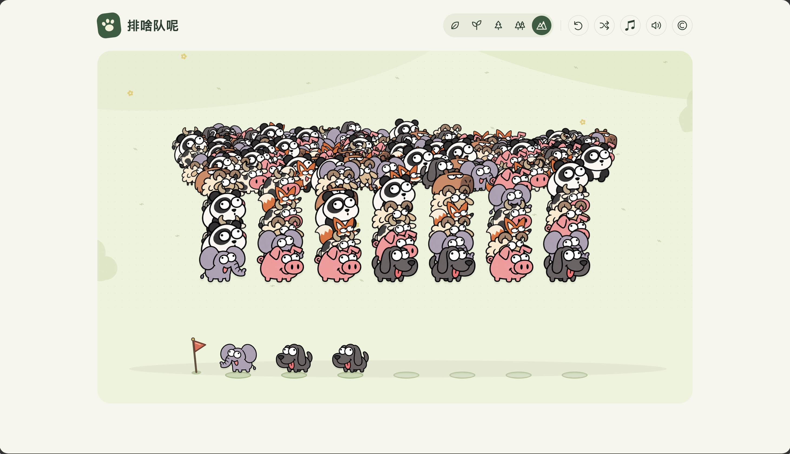

# 排啥队呢

一款卡通动物五消网页游戏。点击队首，把动物一只只移入下方七个位置，凑齐五只同类，让拥挤的长队慢慢散开。共有五关，支持手机、鼠标和键盘；画面以动物和动作反馈为主。

[在线游玩](https://animal-queue-meadow.upbeatcocoa36.chatgpt.site/)

原生 HTML、CSS、JavaScript 实现，无运行时第三方依赖、外部字体或追踪服务。当前为生成器 4、规则 6。



## 本地运行

安装 Node.js 22 或更新版本，然后运行：

```sh
git clone https://github.com/CATO2DL/pai-sha-dui-ne.git
cd pai-sha-dui-ne
npm start
```

打开 <http://127.0.0.1:4173/>。无需 `npm install`。

macOS 也可以双击 `启动游戏.command`。端口被占用时，macOS/Linux 可使用 `PORT=4174 npm start`；PowerShell 使用 `$env:PORT=4174; npm start`。停止服务器请按 Ctrl+C。

请通过 HTTP 服务器运行，直接打开 HTML 文件可能无法加载音频。音效在首次主动操作后启用，背景音乐和游戏音效可以分别关闭。

## 玩法

| 关卡 | 上方队伍 | 动物总数 | 每局种类数 | 每种只数 |
| --- | ---: | ---: | ---: | ---: |
| 1 | 3 | 60 | 4 | 15 |
| 2 | 4 | 100 | 5 | 20 |
| 3 | 5 | 150 | 6 | 25 |
| 4 | 6 | 210 | 7 | 30 |
| 5 | 7 | 280 | 8 | 35 |

每局从 16 种动物中选取相应种类，开局后盘面固定。

首次游玩默认从第一关开始，通关后进入下一关。顶部路径图标可展开选关，五关均可自由选择；选定后入口自动收起，也可再次点图标或按 Esc 收起。刷新仍会续玩已有存档。

- 直接点击上方队首动物，每次只把一只移入下方；后面的同类也要逐次移动。
- 下方是七个固定站位，左侧三角红旗标明队首。同类累计五只即消除，位置可以不相邻；先消耗较早进入的同类，剩余动物依次前移。
- 点击下方只会选择最左边的队首一只，再点击队首同类且尚未关闭的上方队伍，就把这一只移回。返还后，上方连续同类满五只也会自动消除。不能选择中间动物，也不能整组移回。选中下方后，点击无法接收的上方队伍只取消选中，所有动物保持原位；再次点击上方才会取下一只。
- 满七只时，只有下方已存在四只同类、上方再来一只即可立即五消的移动才合法。下方只有三只同类时，不能一次取入上方两只来救场。
- 上方队伍之间不能互相转移。空主队关闭，不能重新放入动物。
- 全部清空即通关；没有合法操作时显示“再试一次”。满位仍有直接五消或合法返还时，可以继续。

键盘操作：`1–9` 操作存在的上方队伍，效果与点击队首相同；`B` 或空格选择／取消下方队首，`Esc` 取消选择；按钮支持 Tab 和回车。选中下方后，数字键可向同类队首返还一只。

存档保存在当前浏览器的 localStorage 中，刷新可以继续。不同浏览器、域名或端口的存档独立。旧存档按原生成器和各步规则回放；升级到规则 6 不重排既有动物，后续新动作使用单只规则。原有历史容量迁移仍保留，新开局使用生成器 4；“再试一次”保留该局生成版本与种子。

## 开发与测试

```sh
npm test
```

56 项测试全部通过，覆盖单只移入／返还、七只容量、满位 4+1 五消、禁止主队互转、先进先出、空队关闭、数量守恒、五关生成及跨版本存档恢复。公开仓库的 GitHub Actions 使用 Node.js 22 运行测试。

最终生成器另经 5,000 局构造证书验证，800,000 次转移动作全部合法并通关。独立的固定可见前缀策略在每关 200 局中分别获胜 183、183、162、146、148 局。这些是自动策略结果，不是真人胜率；第四、五关接近，不能称为严格逐关变难。详细方法、置信区间和每 20% 进度统计见 [单只移动与五关验证报告](SINGLE_CLICK_REPORT.md)。证书只验证开局存在所测通关路线，不保证任意选择之后仍能完成。

界面验证：320×568、375×667 的浏览器视口均无横向或纵向溢出，红旗和七个固定站位在空位、满位与消除后完整显示，桌面画面也已检查。下方选中只更新首只动物的状态，不重建棋盘；每次转移仅重绘发生变化的上方队伍。这是桌面浏览器窄视口验证，不代替真机性能测量。手机截图：[320px](docs/mobile-320.png)、[375px](docs/mobile-375.png)。

| 文件 | 用途 |
| --- | --- |
| `dist/engine.js` | 规则、合法移动和历史回放 |
| `dist/generator.js` | 五关固定种子生成与构造证书 |
| `dist/app.js` | 点击交互、存档与画面渲染 |
| `dist/style.css` | 响应式界面与动画 |
| `dist/sprites.js` | 动物图集坐标及裁切 |
| `dist/audio.js` | 音效和背景音乐 |
| `server.cjs` | 无依赖本地静态服务器 |
| `tests/` | 引擎与策略回归测试 |
| `scripts/` | 验证脚本、冻结引擎和原始结果 |

`dist/` 可部署到支持静态文件的托管服务。公开仓库不包含托管账号的项目配置。

[渐进难度历史报告](RAMP_REPORT.md) 保留生成器 3、规则 3–5 的资料；[早期历史报告](DIFFICULTY_REPORT.md) 保留生成器 2、规则 3 的实验。旧版 95.1% 达到 195 只、3.2% 通关等数值不属于当前版本。部分历史错误日志的本机目录在公开副本中替换为占位符，种子与统计值保留。

## 素材与许可

源码与项目原创内容采用 [MIT 许可](LICENSE)。动物角色图是维护者提供的 AI 生成图，维护者将其拥有的可许可权利按 MIT 提供；原有来源元数据保留。

**第三方音频不改授 MIT**：熊猫录音为 CC BY 4.0，其余所用音乐、动物录音和动作拟音为 CC0 或公有领域素材。熊猫使用对应物种的短鸣；乌龟使用独立的木质轻敲拟音，兔、浣熊、水豚使用轻脚步声。失败音效不含语音。

转载或修改时，请保留适用的作者、许可和修改说明。详情见 [第三方素材说明](THIRD_PARTY_NOTICES.md)、[完整音频署名](dist/assets/CREDITS.txt) 与 [机器可读来源记录](dist/assets/audio-sources.json)。
