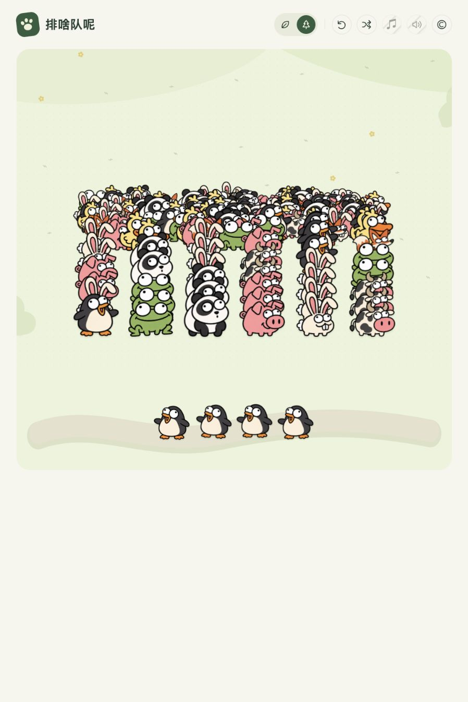

# 排啥队呢

一款卡通动物五消网页游戏。点击队首、腾挪暂存、凑齐五只同类，让拥挤的长队慢慢散开。画面以动物和动作反馈为主，支持手机、鼠标和键盘。

原生 HTML、CSS、JavaScript 实现，无运行时第三方依赖、外部字体或追踪服务。



## 本地运行

安装 Node.js 22 或更新版本，然后运行：

```sh
git clone https://github.com/CATO2DL/pai-sha-dui-ne.git
cd pai-sha-dui-ne
npm start
```

打开 <http://127.0.0.1:4173/>。无需 `npm install`。

macOS 也可以双击 `启动游戏.command`。端口被占用时，macOS/Linux 可使用 `PORT=4174 npm start`；PowerShell 使用 `$env:PORT=4174; npm start`。停止服务器请按 Ctrl+C。

请通过 HTTP 服务器运行，直接打开 HTML 文件可能无法加载音频。音效在首次主动操作后启用，背景音乐和游戏音效可以分别关闭。

## 玩法

- 第一关有 15 只动物、3 条队伍；第二关有 240 只动物、6 条队伍，每局从 16 种动物中抽取 8 种。
- 点选上方队首，再点下方队伍即可暂存。普通移入按空位截取：已有 5 只、选中 3 只时只取 2 只，剩余留在上方。
- 下方结算后最多保留 7 只。同类累计 5 只就消除，位置可以不相邻。
- **满位也能直接五消**：下面已有 3 只熊猫且总数为 7 时，上面的 2 只熊猫仍可移入并直接消除。若上方有更多，只取这次凑五需要的数量，不利用消除后的空位继续取入。
- 下方逐只排列，但取回仍按先进先出的一组进行；选中下方再点击同类主队，可以逐步累加。
- 两条上方主队之间，只有同类合计至少 5 只、能够直接消除时才能转移。空主队关闭，不能重新放入动物。
- 全部清空即通关；没有合法操作时显示“再试一次”。满位但还有直接五消机会时，仍可继续。

键盘操作：`1–9` 选择队伍，`B` 选择暂存队首，空格移入暂存，`Esc` 取消；按钮支持 Tab 和回车。

存档保存在当前浏览器的 localStorage 中，刷新可以继续。不同浏览器、域名或端口的存档独立。当前为生成器 3、规则 5；保留旧生成器和旧规则回放，升级后不重置已有盘面。第二关的盘面开局固定，可能无解。

## 开发与测试

```sh
npm test
```

36 项引擎测试覆盖五消、7 只容量、满位直接消除、只取所需数量、先进先出、死局判断、数量守恒以及跨版本存档恢复。GitHub Actions 使用 Node.js 22 自动运行测试。

| 文件 | 用途 |
| --- | --- |
| `dist/engine.js` | 规则、生成器、合法移动和历史回放 |
| `dist/app.js` | 点击交互、存档与画面渲染 |
| `dist/style.css` | 响应式界面与动画 |
| `dist/sprites.js` | 动物图集坐标及裁切 |
| `dist/audio.js` | 音效和背景音乐 |
| `server.cjs` | 无依赖本地静态服务器 |
| `tests/` | 引擎回归测试 |
| `scripts/` | 历史模拟、冻结引擎和结果记录 |

`dist/` 可部署到支持静态文件的托管服务。此仓库不包含某个托管账号的项目配置。

难度实验见 [渐进难度报告](RAMP_REPORT.md) 和 [历史报告](DIFFICULTY_REPORT.md)。其中 95.1% 达到 195 只、3.2% 通关是**旧规则 4 的固定自动策略结果**，不代表当前规则 5 或真人胜率；规则 5 尚未重新测量胜率。开源副本中少量历史错误日志的本机目录已替换为占位符，种子与统计值保留。

## 素材与许可

源码与项目原创内容采用 [MIT 许可](LICENSE)。动物角色图是维护者提供的 AI 生成图，维护者将其拥有的可许可权利按 MIT 提供；原有来源元数据保留。

**第三方音频不改授 MIT**：熊猫录音为 CC BY 4.0，其余所用音乐、动物录音和动作拟音为 CC0 或公有领域素材。熊猫使用对应物种的短鸣；乌龟使用独立的木质轻敲拟音，兔、浣熊、水豚使用轻脚步声。失败音效不含语音。

转载或修改时，请保留适用的作者、许可和修改说明。详情见 [第三方素材说明](THIRD_PARTY_NOTICES.md)、[完整音频署名](dist/assets/CREDITS.txt) 与 [机器可读来源记录](dist/assets/audio-sources.json)。
